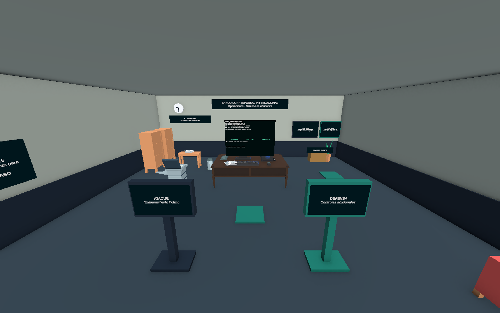
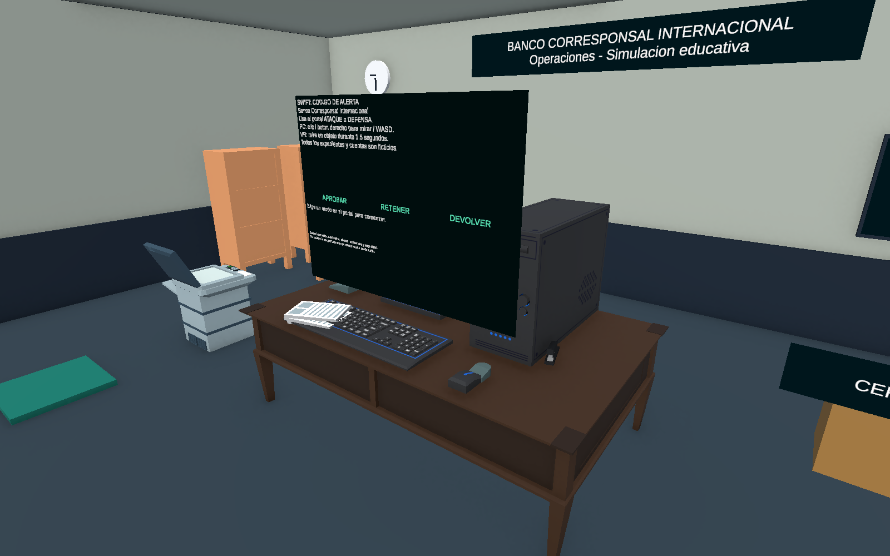
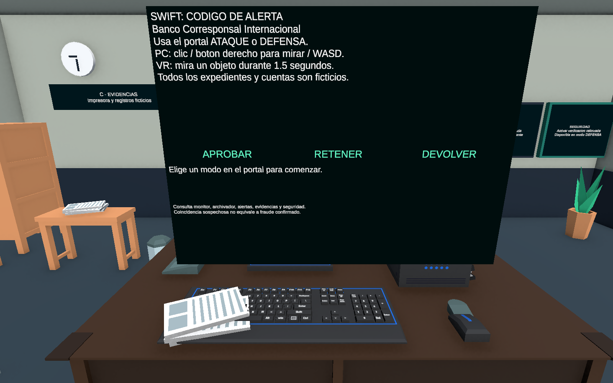
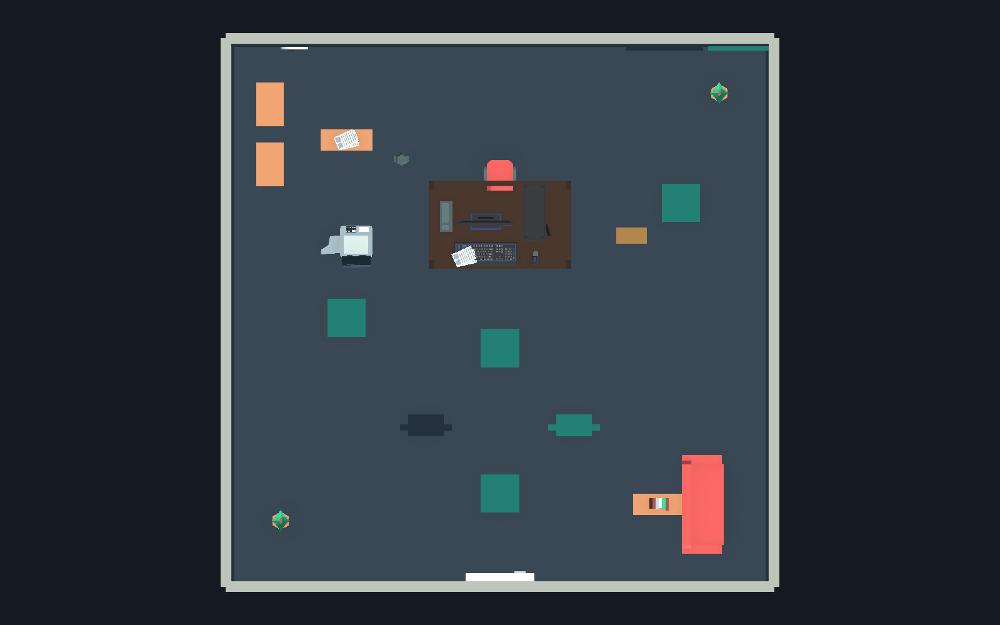

# Revision de BancoCorresponsal

UTC: 2026-10-29T06:31:17.6753088Z

Unity: 6000.3.24f1 / URP 17.3.0

Escena SHA-256: `079f58cff327ecd33cb561dab8eba96235db81978bd58688fc48b740a947c767`

Capturas reales del Editor en modo Edicion. No certifican VR, rendimiento ni textos creados solo durante Play. La vista superior oculta temporalmente el techo.

## 01-oficina.png

## 02-escritorio.png

## 03-computadora-expedientes.png

## 04-distribucion-superior.png

