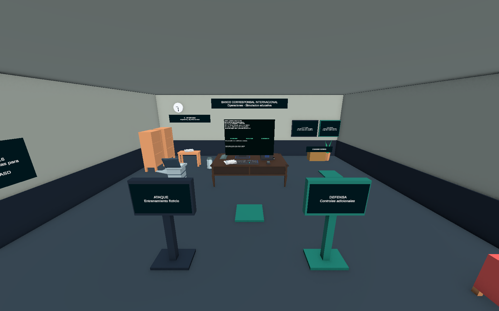
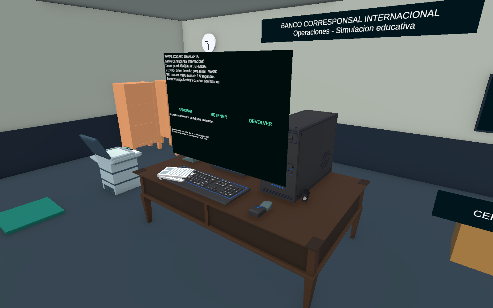
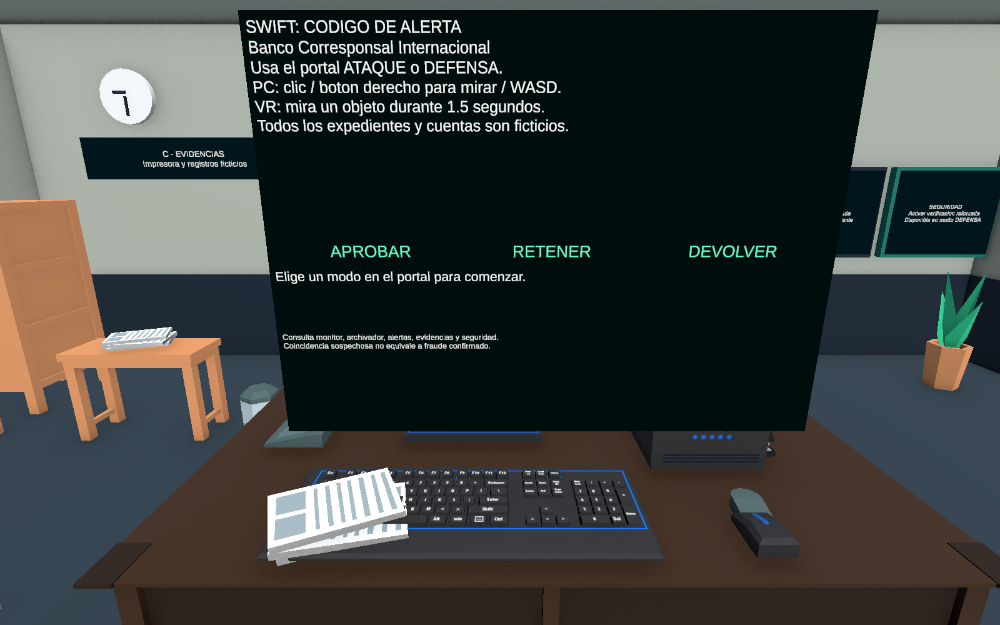
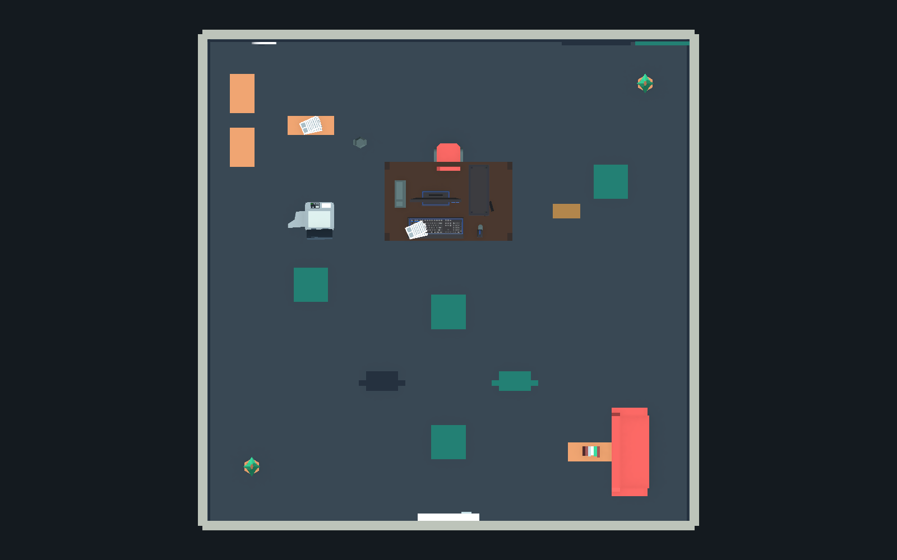

# Capturas de TrialProject — BancoCorresponsal

**Origen: TrialProject**, copia de prueba aislada del proyecto SWIFT_CodigoDeAlerta. Sesión `20261029T170749356Z-3a6e29`.

Estas imágenes se generaron y revisaron en esa copia mediante Unity 6000.3.24f1 / URP 17.3.0. Se publican únicamente como evidencia visual: no incorporan la integración MCP, scripts de prueba ni cambios de escena al repositorio original. `capture.json` y los cuatro PNG se conservan idénticos a los originales de la sesión.

Observaciones: el Canvas cubre parte del monitor y los papeles se superponen al teclado. Console registró cuatro advertencias de `Camera.stereoTargetEye` con URP y ningún error. Son capturas en modo Edición; no acreditan una prueba Android/VR ni una transferencia en ejecución.

UTC: 2026-10-29T17:07:49.3774810Z

Unity: 6000.3.24f1 / URP 17.3.0

Escena SHA-256: `079f58cff327ecd33cb561dab8eba96235db81978bd58688fc48b740a947c767`

Capturas reales del Editor en modo Edicion. No certifican VR, rendimiento ni textos creados solo durante Play. La vista superior oculta temporalmente el techo.

## 01-oficina.png

## 02-escritorio.png

## 03-computadora-expedientes.png

## 04-distribucion-superior.png

