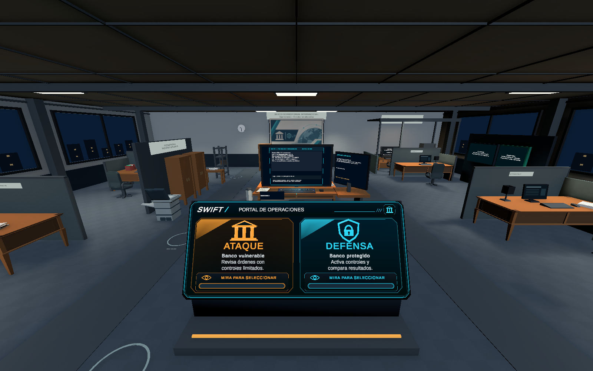
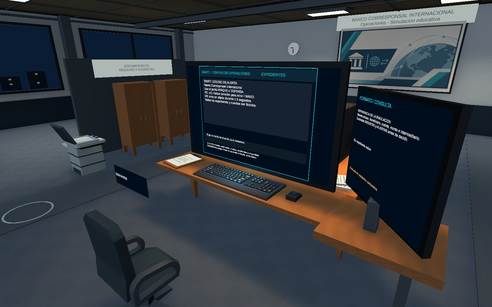
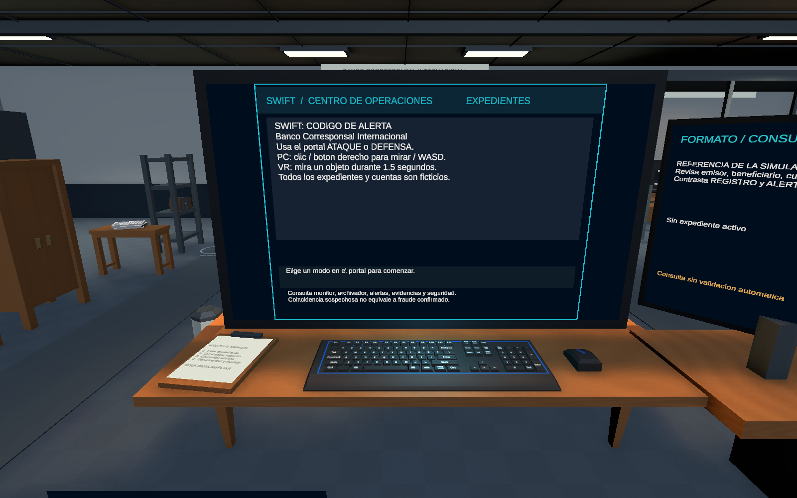
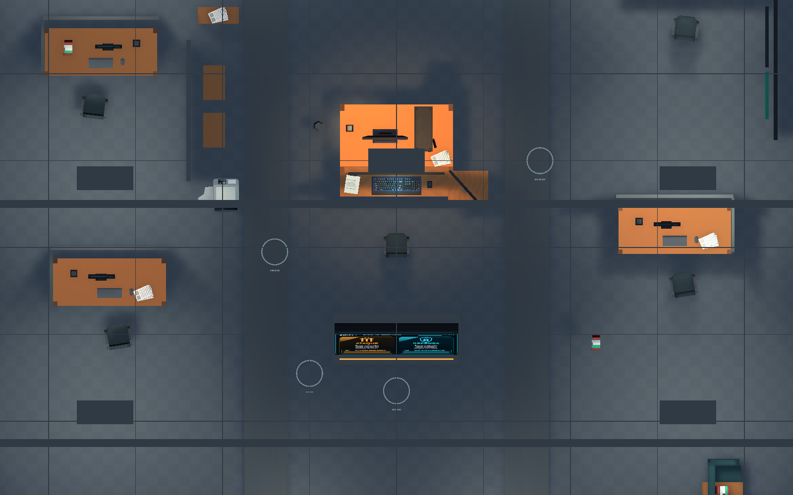

# Revision de BancoCorresponsal

UTC: 2026-11-10T08:37:54.5101348Z

Unity: 6000.3.24f1 / URP 17.3.0

Escena SHA-256: `df79b449b7071e793c2ab326bb1543a004fd90cdcf0b9b5fd11d077f78beb39a`

Capturas reales del Editor en modo Edicion. No certifican VR, rendimiento ni textos creados solo durante Play. La vista superior oculta temporalmente el techo.

## 01-oficina.png

## 02-escritorio.png

## 03-computadora-expedientes.png

## 04-distribucion-superior.png

