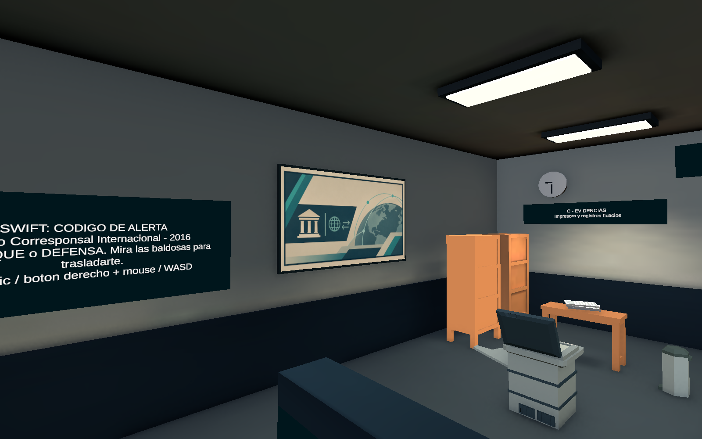
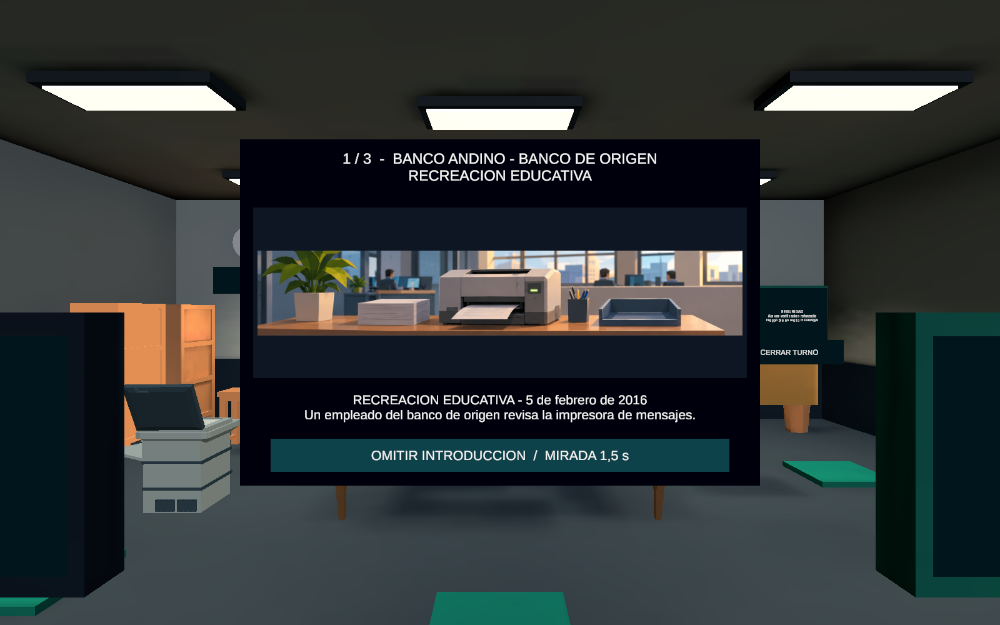
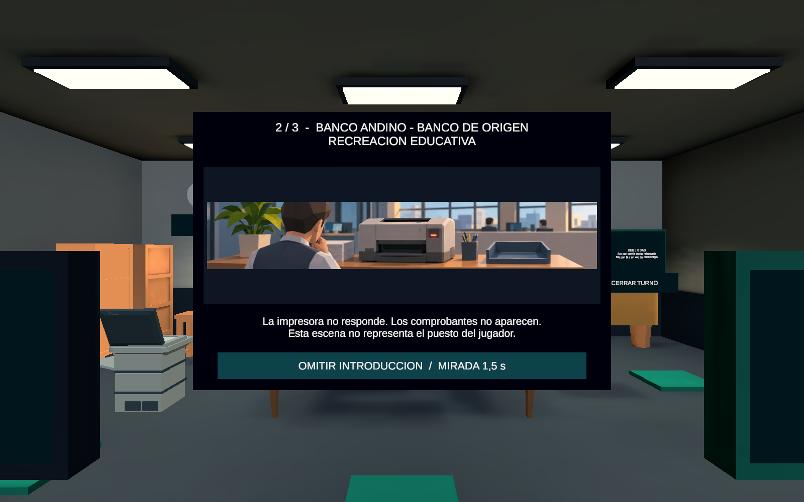
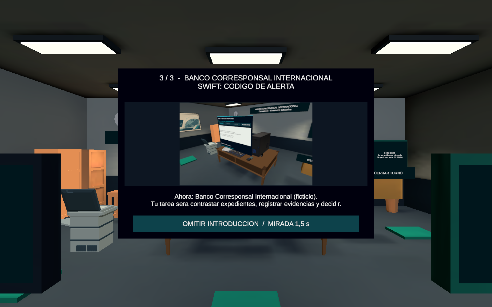
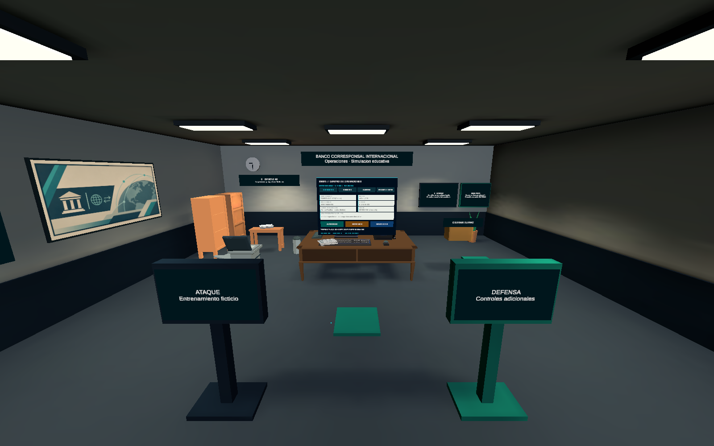
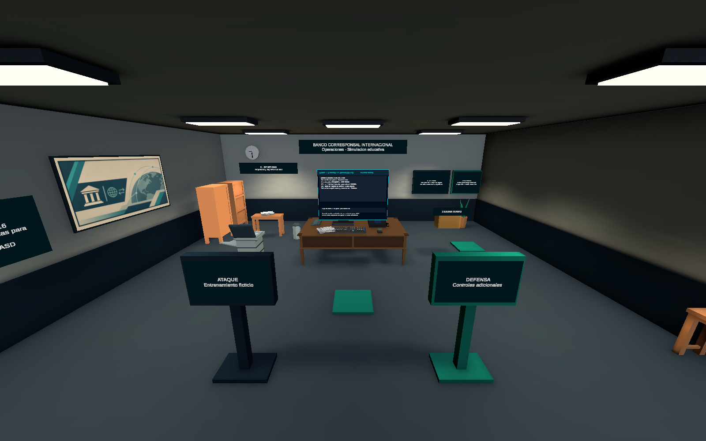
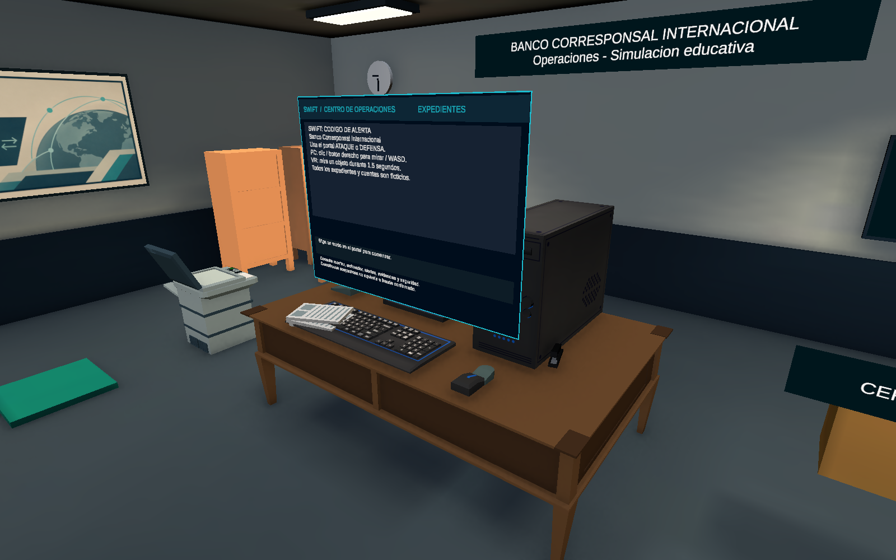
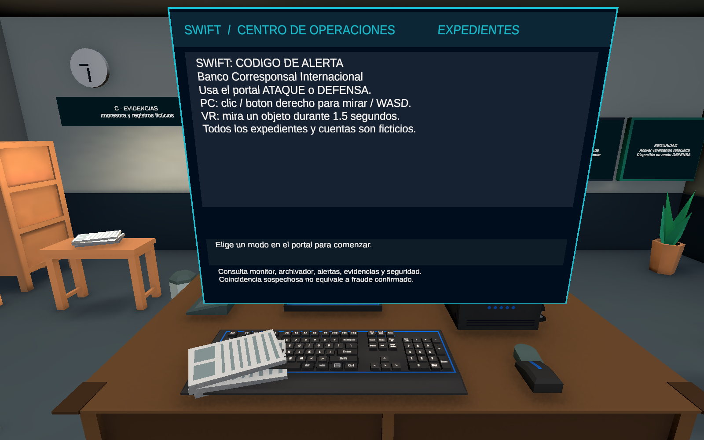
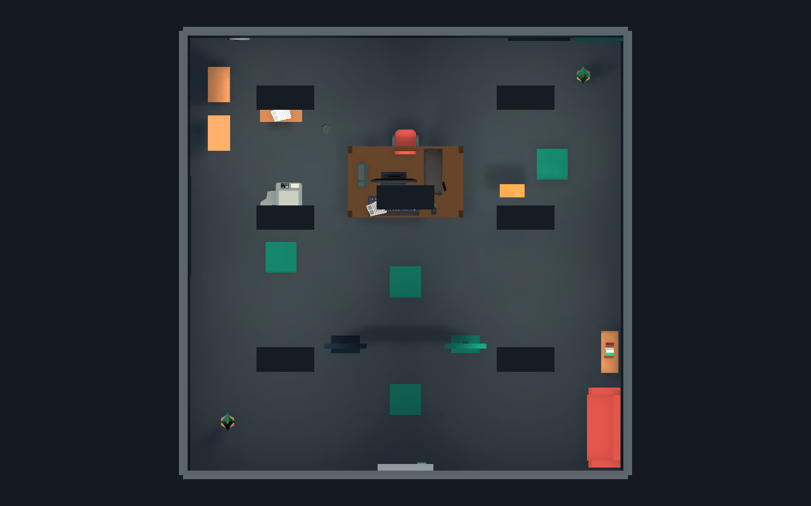

# Integracion de artes: grafica institucional y prologo

Unity 6000.3.24f1 / URP 17.3.0. Nueve renders reales a 1600 x 1000. Estados de Edicion y Play Mode diferenciados debajo. No son capturas Android ni estereoscopicas; no certifican rendimiento o confort.

[Informe de integracion y archivos modificados](../../../Context/ART_INTEGRATION_REPORT.md). Datos, fechas y SHA256 en capture.json; posiciones y Play/Edicion en capture-receipt.txt.

Pruebas: 27 checks de dominio PASS; revision especifica de arte PASS; GameplayFlowProbe, BankOfficeProbe y PrototypeSmokeProbe ejecutadas de nuevo, todas PASS. Android/HONOR y aprobacion visual del usuario pendientes.

Escena SHA256: `49732a91cd0b00f3a3a7dd4fb1784b574517ae92b1db04744a8c6fe75c264218`. Sin commit/push.

Las carpetas iteration-wall-first e iteration-prologue-edit-render conservan intentos anteriores y no son el resultado final.

## 01-grafica-pared.png - Edicion

Grafica institucional final en pared oeste, entre bienvenida y archivadores, sin bloquear recorrido.

## 02-prologo-impresora.png - Play Mode

Momento 1: impresora en banco de origen; area util original mediante UV, subtitulos TMP y Omitir.

## 03-prologo-detenida.png - Play Mode

Momento 2: impresora detenida y empleado generico del banco de origen.

## 04-prologo-banco-real.png - Play Mode

Momento 3: render real del banco con la interfaz actual, en lugar de la oficina conceptual.

## 05-oficina-partida.png - Play Mode

Oficina despues del inicio unico de defensa: expediente activo, cuadro e interacciones existentes.

## 06-oficina-general.png - Edicion

Vista general de entrada, cuadro, escritorio y circulacion.

## 07-escritorio.png - Edicion

Relacion del nuevo cuadro con el escritorio y mobiliario existente.

## 08-computadora.png - Edicion

Monitor serializado en Edicion; la UI nativa actual se muestra en las capturas de Play Mode.

## 09-distribucion-superior.png - Edicion

Distribucion y pads; techo oculto temporalmente solo para esta captura.

