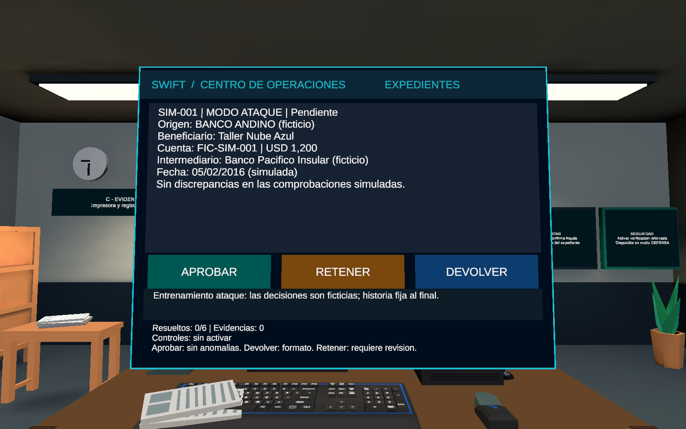
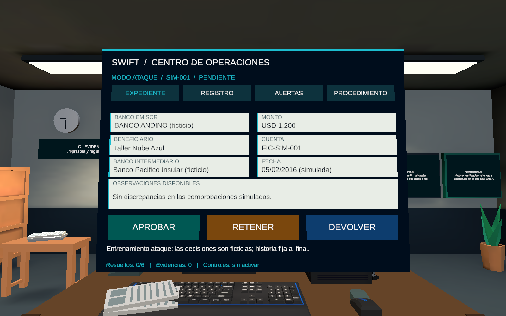
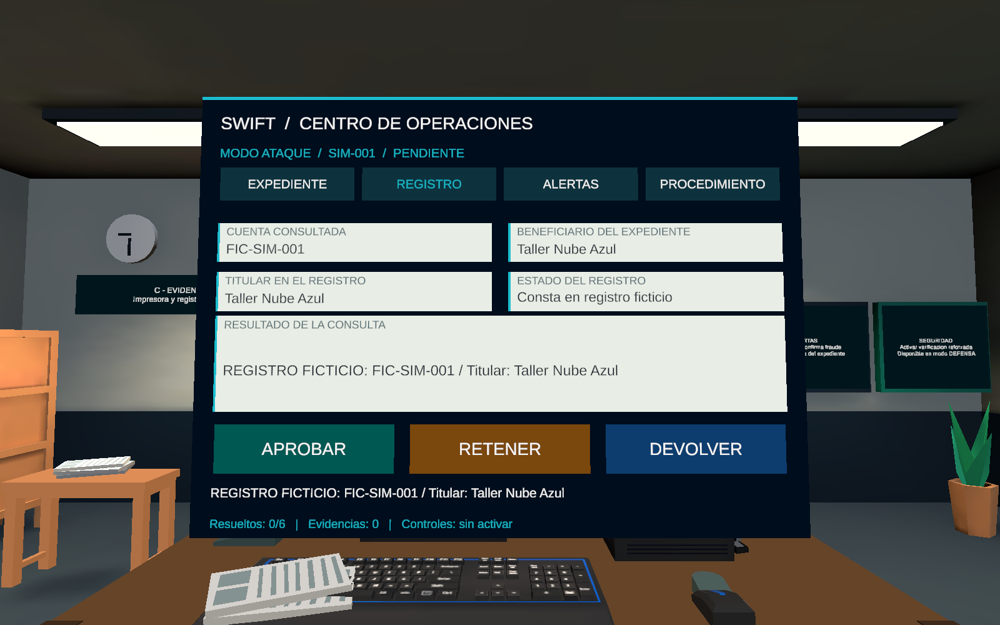
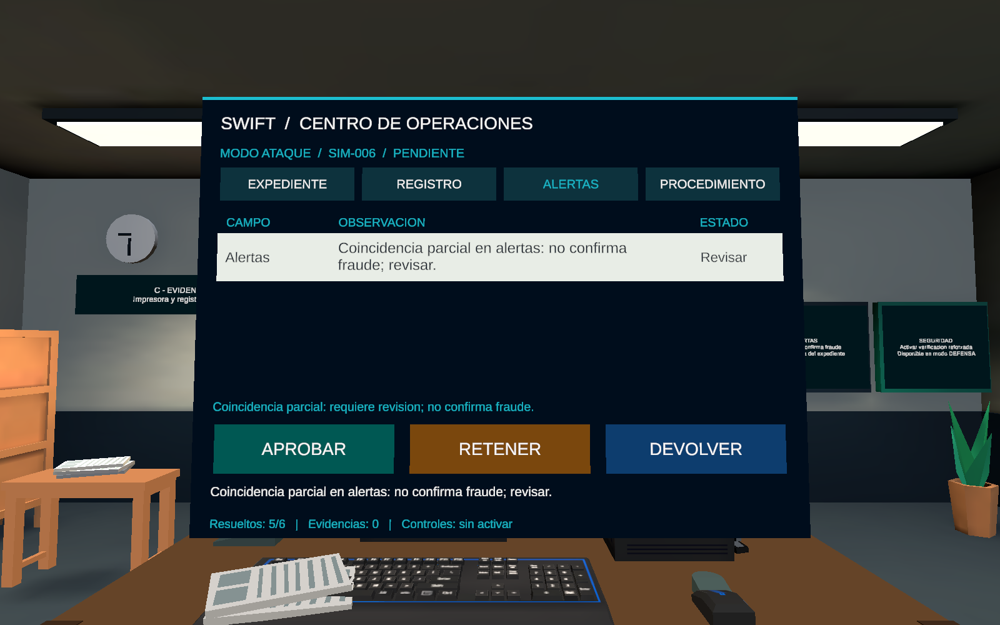
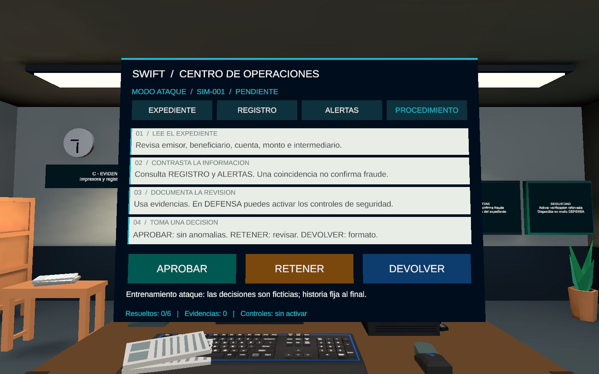
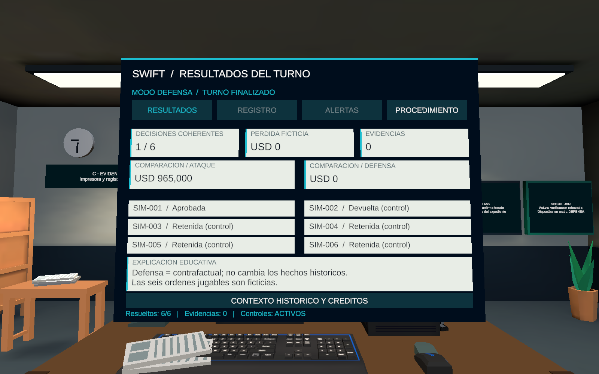
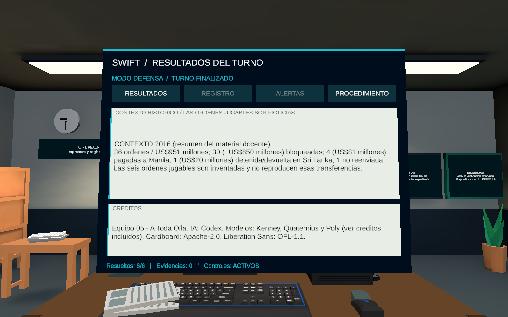

# Revisi?n real de documentos / Propuesta C

Unity 6000.3.24f1 / URP 17.3.0. Renders reales del Editor en Play Mode a 1600 ? 1000 desde inspecci?n. No son capturas de Android ni estereosc?picas.

Escena preservada: `41467b15703bff8b588c7f36c6a76c684483b1f44ca3a315074961b59c3c3d92`. Pruebas finales: PASS, 1107 aserciones (incluye comprobaciones repetidas de textos/bloques por estado), m?s 27 checks de dominio. Sin errores runtime durante la revisi?n. Android pendiente.

[Informe de implementaci?n](../../../Archive/2026-11-10/Context/DOCUMENT_UI_IMPLEMENTATION.md). Hashes y fechas en capture.json; par?metros de captura en capture-receipt.txt. iteration-1 conserva la versi?n anterior al ajuste final de etiquetas/alertas.

## 01-expediente-anterior.png

## 02-expediente-mejorado.png

## 03-consulta-registros.png

## 04-panel-alertas.png

## 05-procedimiento.png

## 06-resultados.png

## 07-contexto-creditos.png

## 08-progreso-mirada-editor.png

