# Rediseño inmersivo de BancoCorresponsal

2026-11-02. Unity 6000.3.24f1 / URP 17.3.0. Rama local review/environment-immersive.

Capturas reales a 1600 × 1000 mediante cámara temporal del Editor; las vistas de Play muestran datos TMP dinámicos. Las de Edición muestran el monitor serializado anterior al montaje runtime. No son imágenes IA ni capturas estereoscópicas de Android.

Oficina: 16 × 14 m, cuatro cubículos y puesto del analista. Cuatro destinos originales conservados y dos adicionales de exploración con el mismo sistema de mirada. No se miden FPS, batches o confort con estos PNG.

## Oficina anterior, Edición; misma cámara que 02

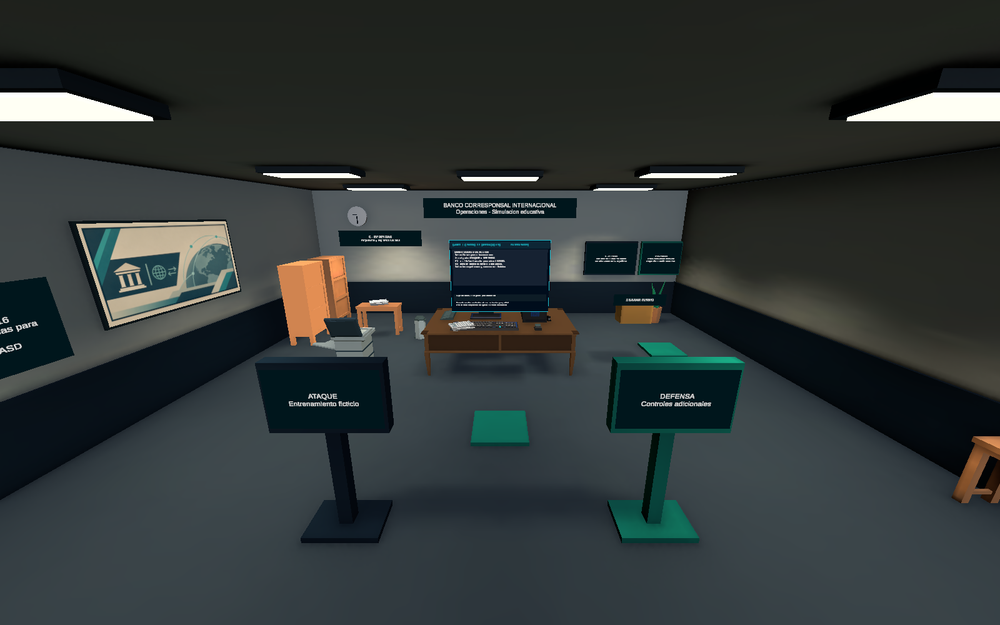

## Planta anterior, techo oculto temporalmente; misma cámara que 10

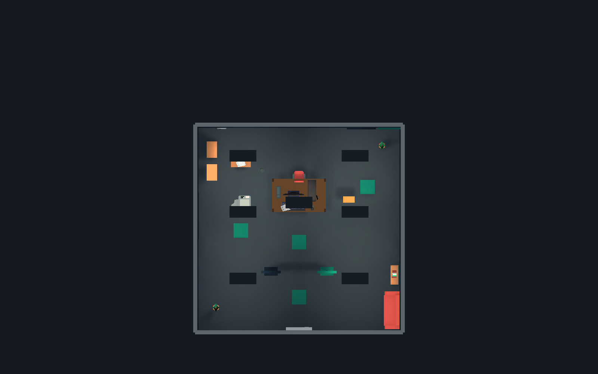

## Oficina ampliada, Edición después del bake

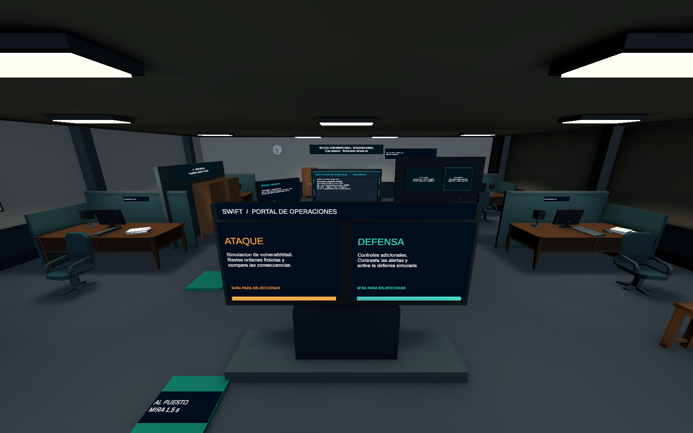

## Consola única y dos opciones originales, Edición

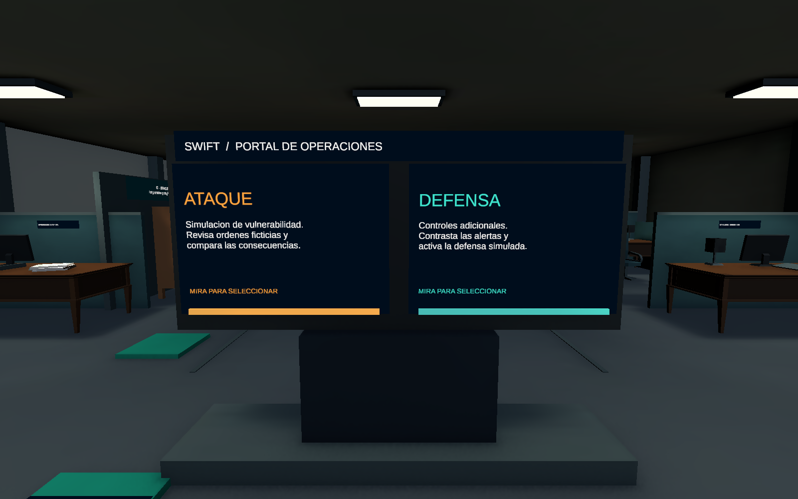

## Cubículos y archivo, Edición

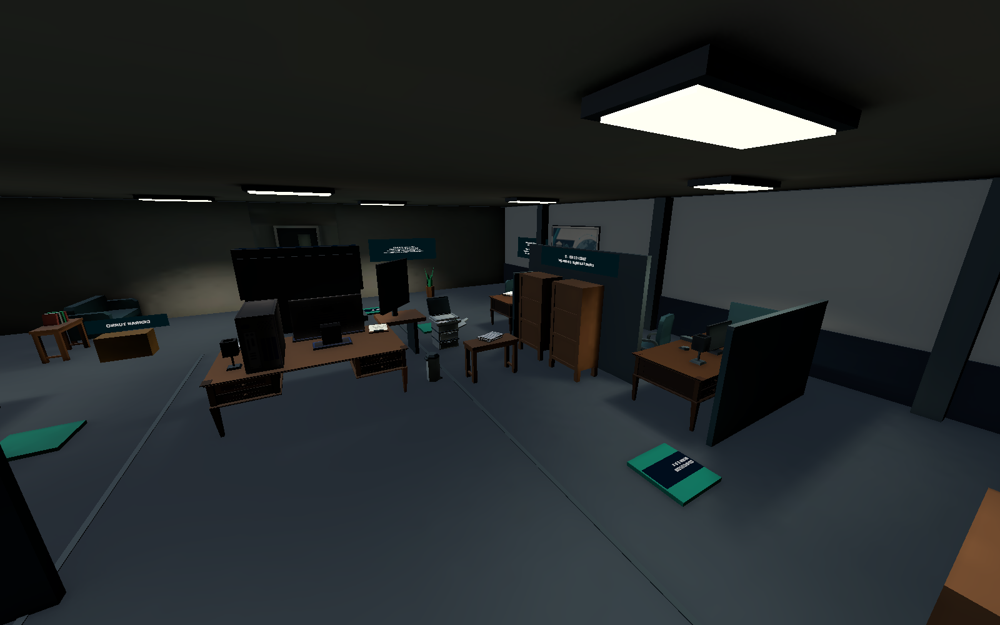

## Puesto desde inspección de pie, Play Mode

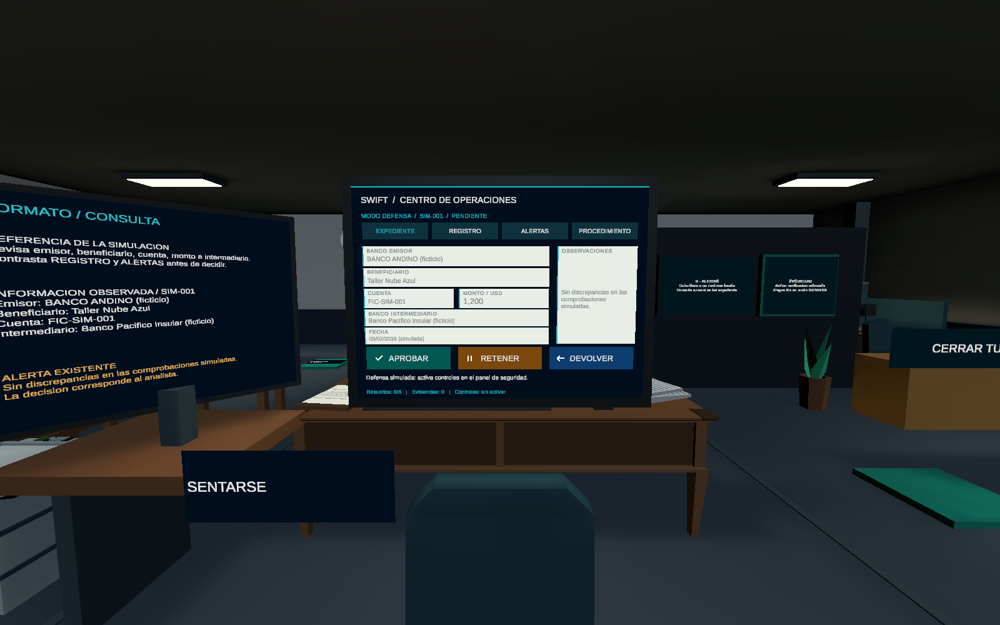

## Puesto sentado y monitores, Play Mode

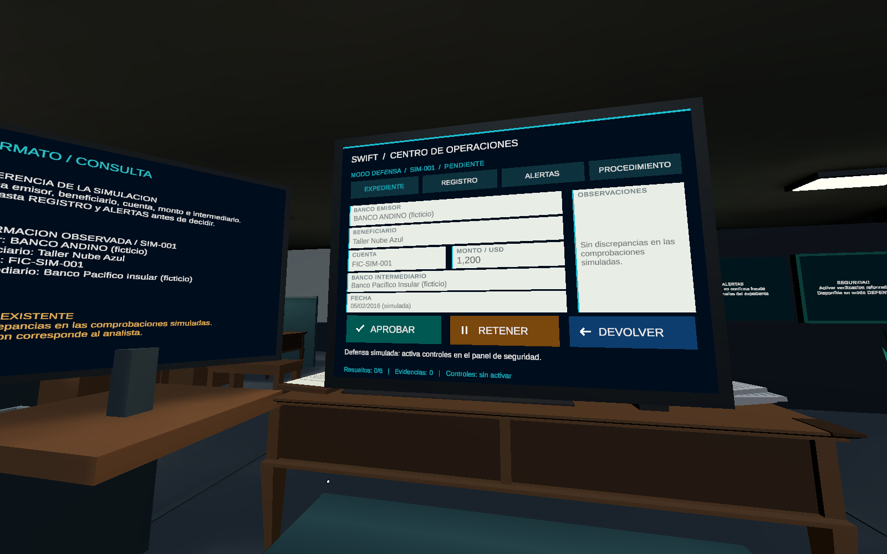

## Expediente y tres decisiones, Play Mode

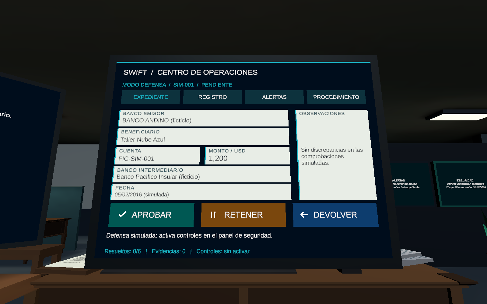

## Consulta de formato y clipboard, Play Mode

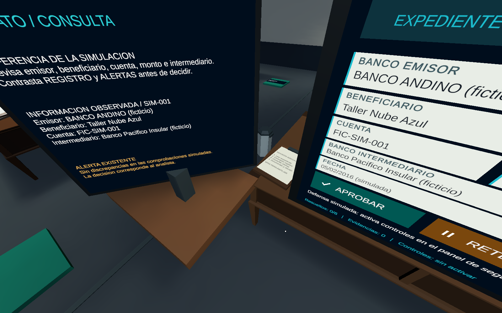

## Familias de materiales e iluminación horneada, Edición

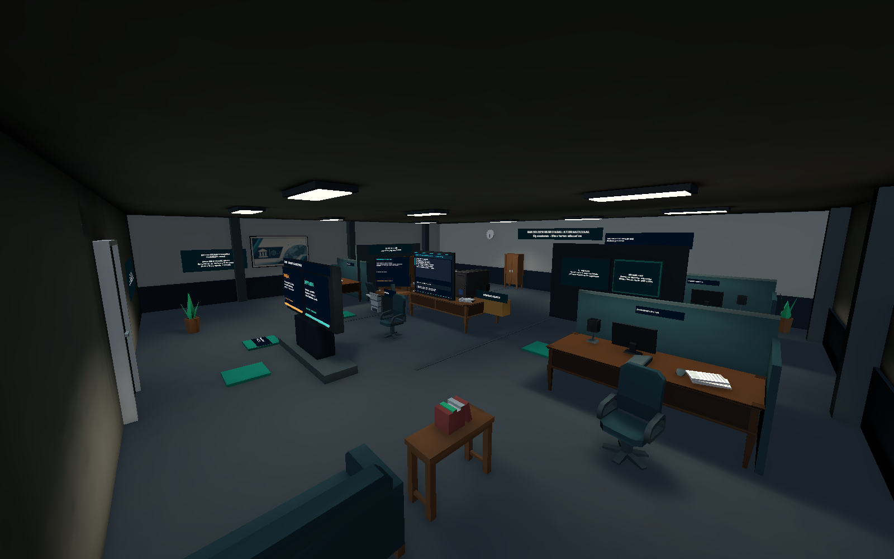

## Planta ampliada, techo oculto temporalmente, Edición

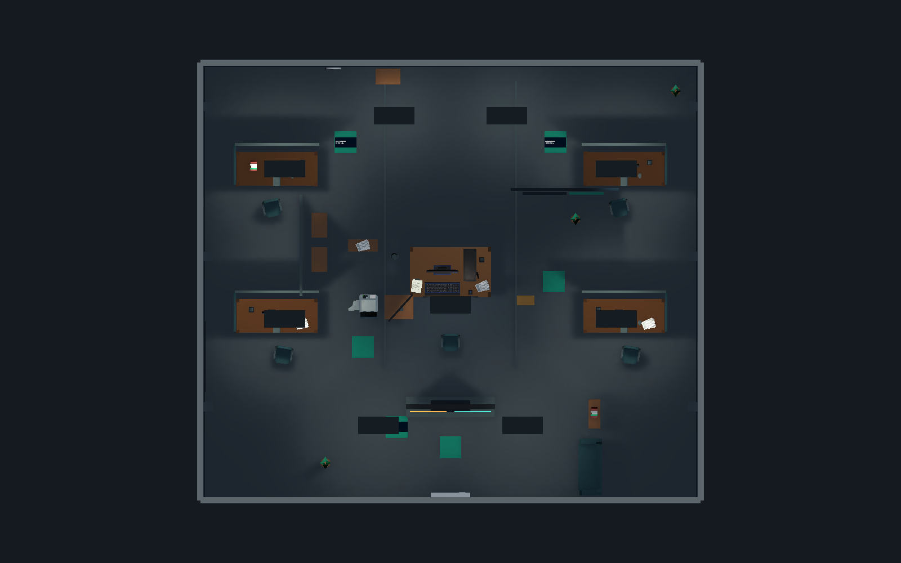

## LEVANTARSE desde el ojo sentado, Play Mode

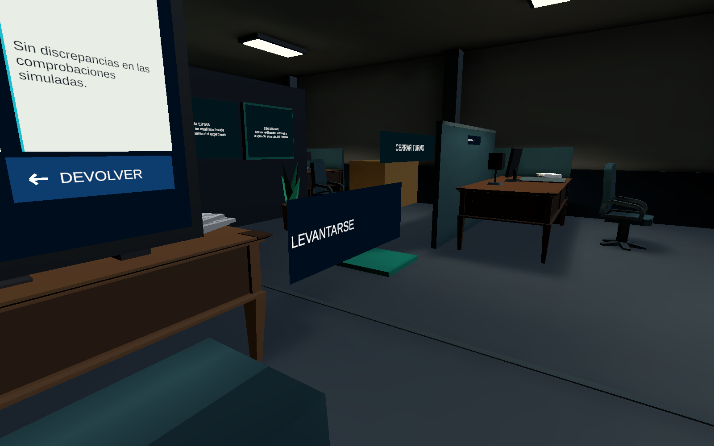

## Evidencia

Fechas por captura: capture-receipt.txt; hashes y contexto: capture.json; resultados ejecutados: tests.json. La galería final se captura después del bake; iteration-1 conserva intentos anteriores.

Revisión estética del usuario y HONOR/Cardboard pendientes. Informe: ../../../Context/ENVIRONMENT_REDESIGN_PROGRESS.md.
