# Graphics Polish V2 — comparación real de Unity

**Revisión aislada; todavía no integrada en BancoCorresponsal ni en una APK.**

Abrir `Assets/_Project/Scenes/Review/BancoCorresponsal_GraphicsV2.unity` con Unity 6000.3.24f1 / URP 17.3.0. La exclusividad de edición no quedó confirmada; la principal se conserva byte por byte. Sin commit/push. Informe: [GRAPHICS_POLISH_V2_REPORT](../../Archive/2026-11-10/Context/GRAPHICS_POLISH_V2_REPORT.md).

Before se capturó de una copia nueva del estado actual antes de editar, no se reutilizaron PNG de otra sesión. After corresponde al bake final. Son renders Unity DX11, PC_RPAsset, 1600 × 900 y FOV vertical 60. Las siete parejas usan las mismas posiciones/destinos; coordenadas y fechas en [capture-receipt.txt](capture-receipt.txt), hashes en [capture-manifest.json](capture-manifest.json). No son referencias IA ni pruebas en teléfono.

| Vista | Antes | Después | Cambio visible |
|---|---|---|---|
| Entrada | 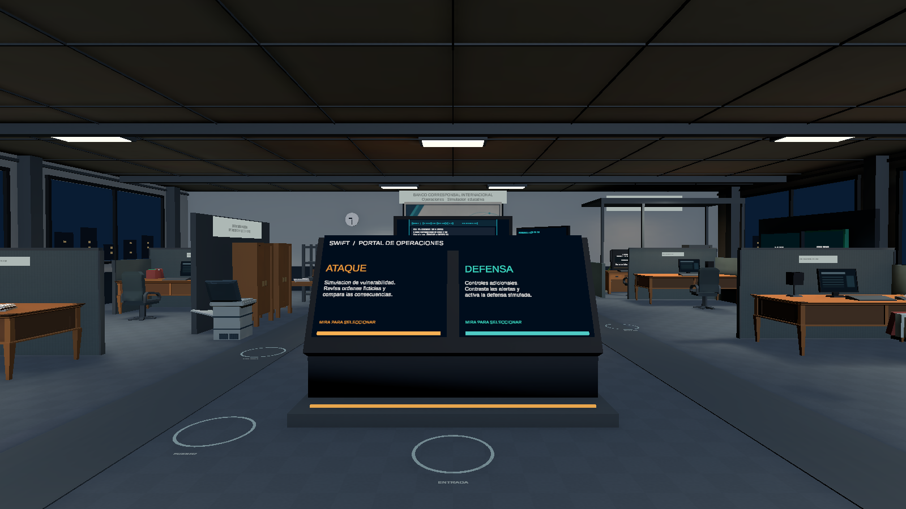 | 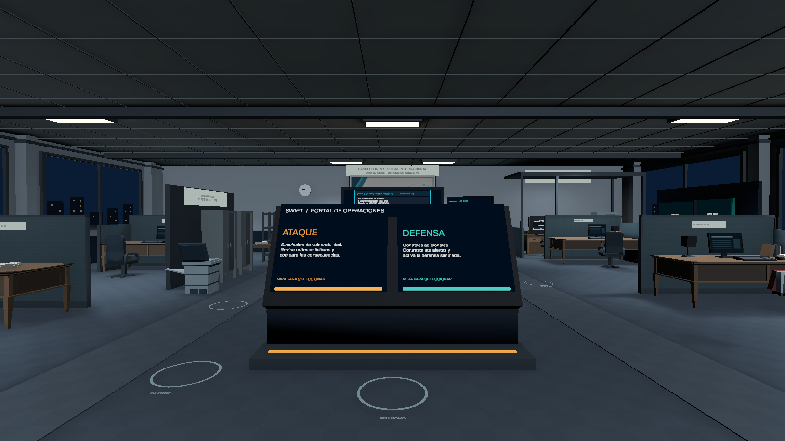 | Madera sobria, archivos metálicos, techo/columnas más diferenciados. |
| Oficina general | 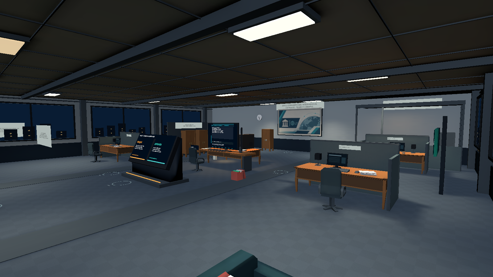 | 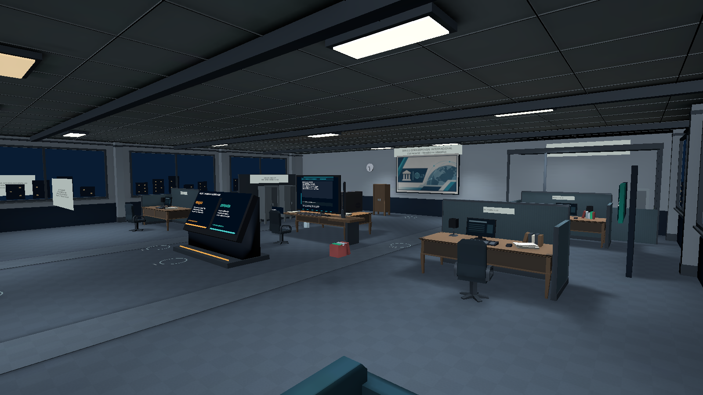 | Materiales coherentes y libros en sus propios escritorios. |
| Cubículos | 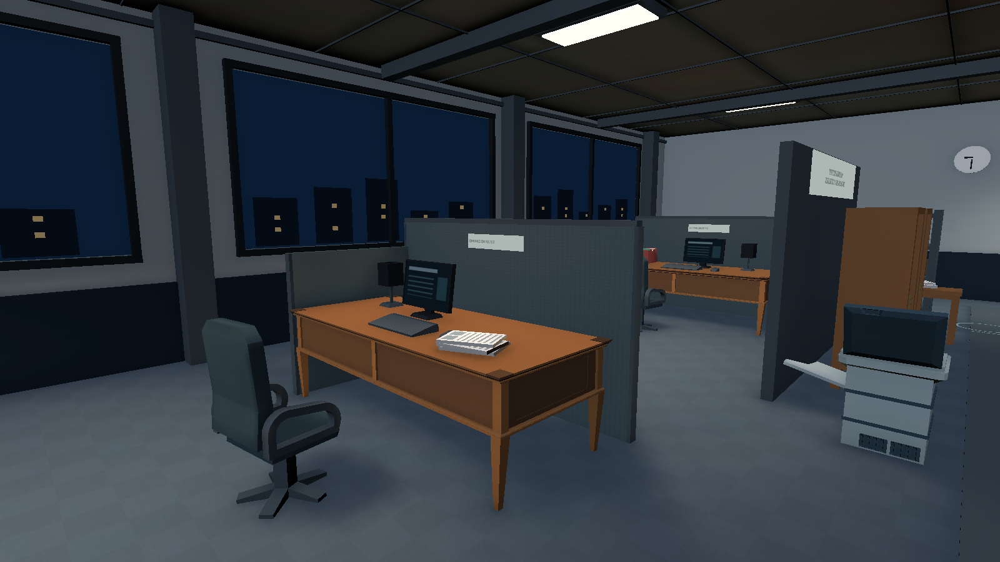 | 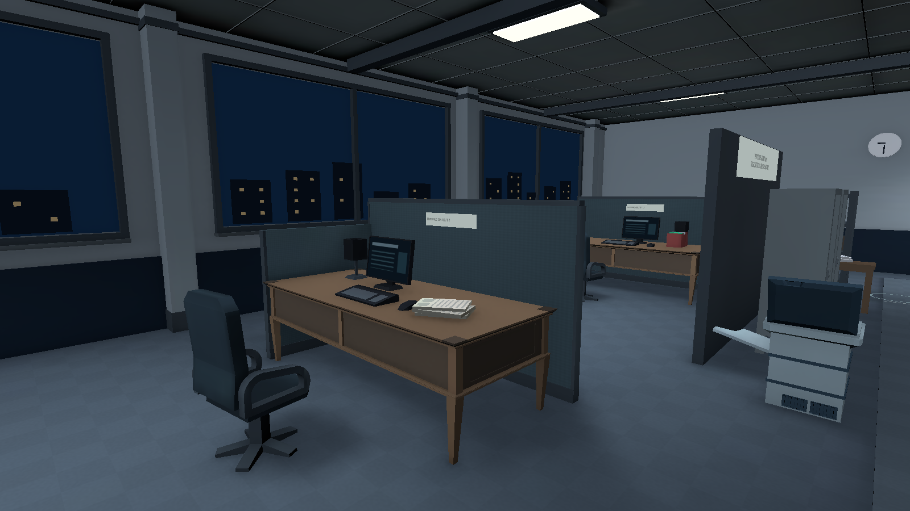 | Papel marfil, plásticos separados, remates de mampara y ventanas. |
| Puesto principal | 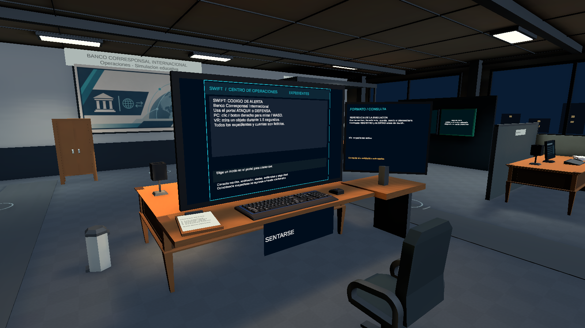 | 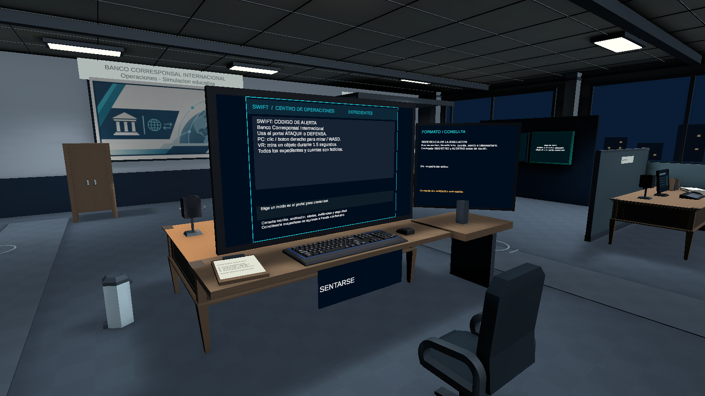 | Madera desaturada y acento cálido menos naranja; mismos monitores/controles. |
| Documentación | 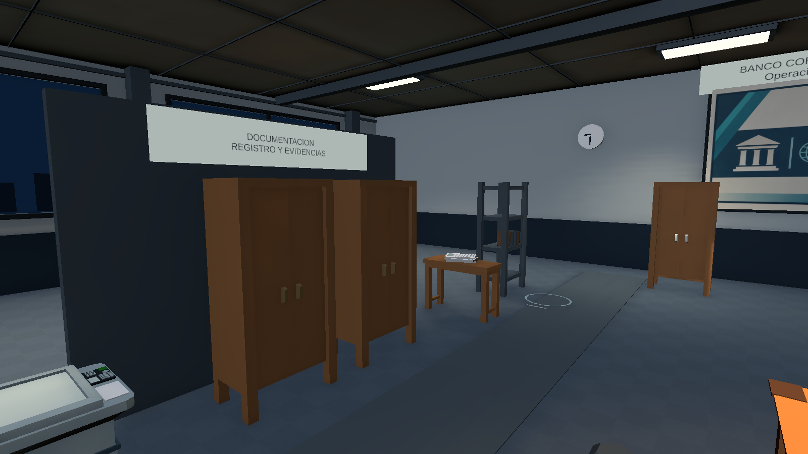 | 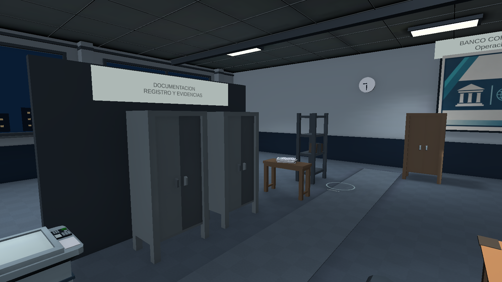 | Archivo esmaltado distinto de madera y pared; consultas intactas. |
| Supervisión | 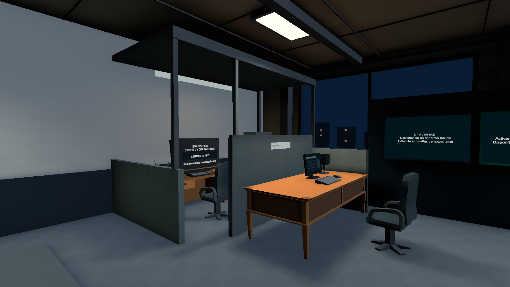 | 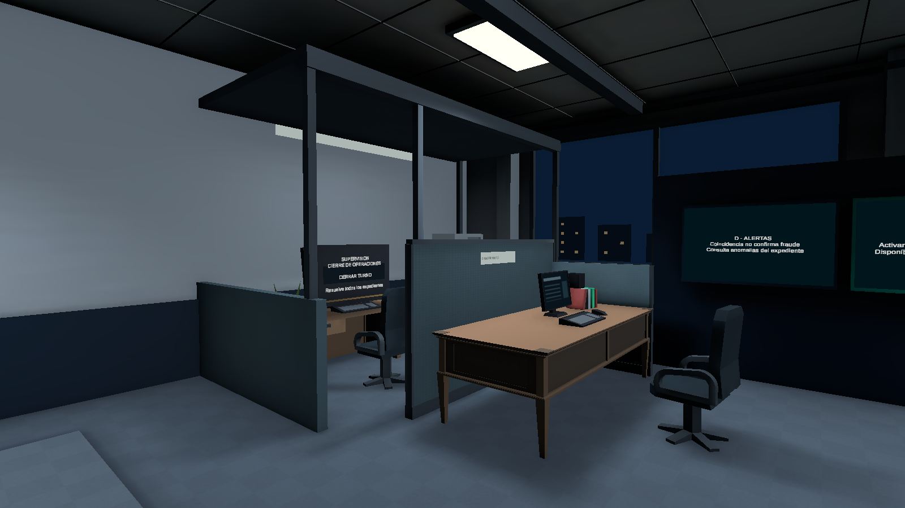 | Mesa neutra, libros apoyados y terminal de cierre original. |
| Vista nocturna | 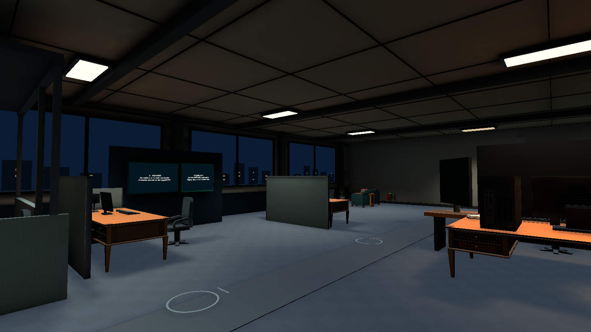 | 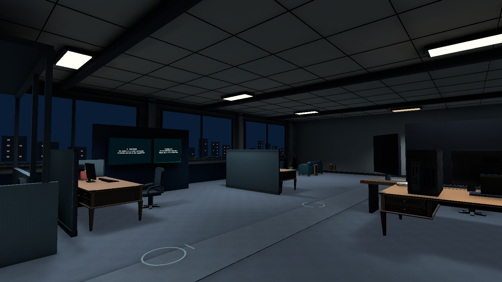 | Ciudad opaca con ventanas dentro de las siluetas; luz azul gris contenida. |

## Distribución y juego

[Planta antes](Before/08-planta.png) / [planta después](After/08-planta.png): ortográfica técnica, techo y juntas ocultos solo para capturar; se restauran. Se conservan 20 × 18 m y recorridos.

Las carpetas Materials/Architecture guardan pasos intermedios. [Monitor centrado desde asiento](Play/06-monitor-centrado.png) y [puesto de pie](Play/03-puesto-de-pie.png) son UI dinámica en Play. [Detalle teclado/libreta](Play/05-libreta-teclado.png) es un encuadre inferior; `04-puesto-sentado` también apunta más abajo y recorta la parte superior del monitor, no demuestra overflow de TMP. El encuadre centrado sirve para revisar la pantalla completa. [Cierre](Play/02-supervision-terminal.png) conserva la acción End original. FunctionalDetails guarda la sonda de entorno.

Profiles/PC-same-camera.png y Profiles/Mobile-same-camera.png usan temporalmente los dos perfiles existentes y restauran el original. No cambian assets de calidad ni equivalen a estereoscopía o rendimiento del HONOR.

## Validación

Todos los recibos de esta sesión: [validation-results.json](validation-results.json). DomainTests 27/27; GameplayFlowProbe, BankOfficeProbe, PrototypeSmokeProbe, revisión de entorno y prueba V2 de mirada/cierre/silla/acciones/TMP: PASS Editor. Bake y comparación exacta de acciones/destinos/colliders: PASS. Android NO PROBADO. Frame Debugger, overdraw real, GPU/FPS/temperatura pendientes.

## Inventario (no benchmark)

| Métrica | Antes | Después |
|---|---:|---:|
| MeshRenderer activos | 284 | 288 |
| Materiales distintos visibles | 49 | 54 |
| Triángulos con renderer habilitado | 31228 | 32718 |
| Luces baked | 17 | 17 |
| Luces realtime | 1 | 1 |
| Atlas de lightmap | 1 | 1 |
| Sondas de luz | 81 | 81 |
| Reflexiones baked | 1 | 1 |

Incremento geométrico: 1,490 triángulos (4.77 %). Se verifican 995 archivos previos de Assets/Packages/ProjectSettings: ninguno modificado o eliminado. La biblioteca nueva tiene 18 materiales compartidos; reemplaza referencias de la copia, no añade 18 variantes a cada objeto.

Persisten estética low-poly, dentado y posible parpadeo de juntas/tejido/textos al usar MSAA1. Las capturas no prueban comodidad binocular ni ausencia de moiré en movimiento. No se afirma reproducción literal de las referencias ni aprobación artística del usuario.

## Recuperación e integración

Respaldo: `D:/UnityGames/SWIFT_Backups/GraphicsPolishV2-20261103-135942`; checkpoints por fase y copia final. La escena principal no se editó. Una vez resuelta la concurrencia, la integración preparada exige hashes del origen y de la revisión validada; si cambiaron debe reconciliarse selectivamente. Abrir después la principal, repetir validación y compilar APK nueva.
