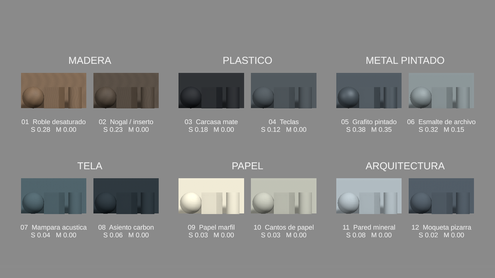
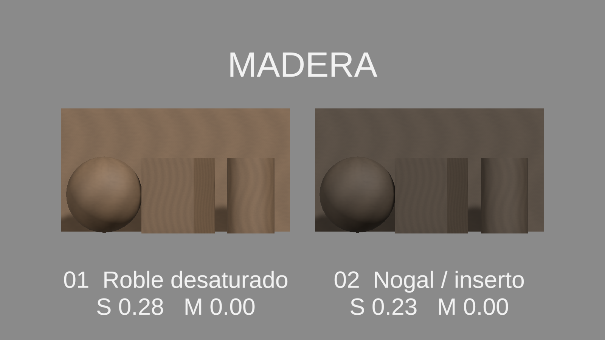
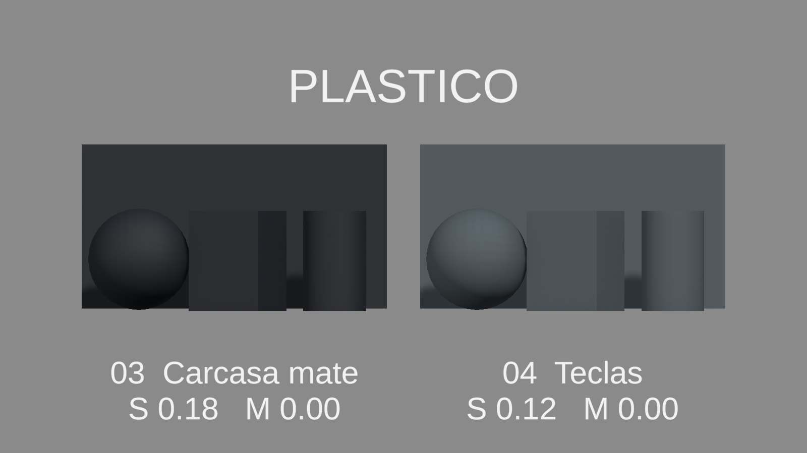
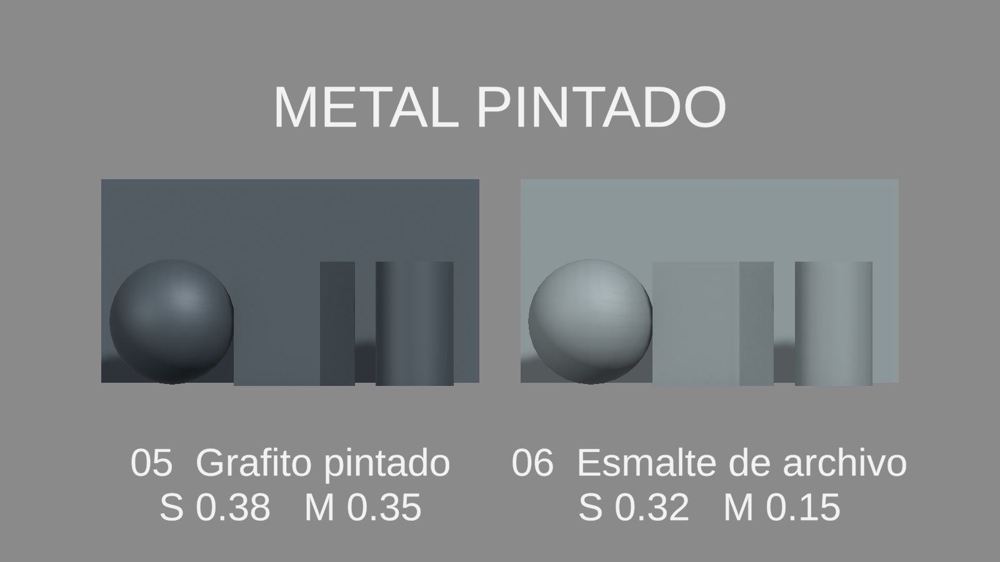
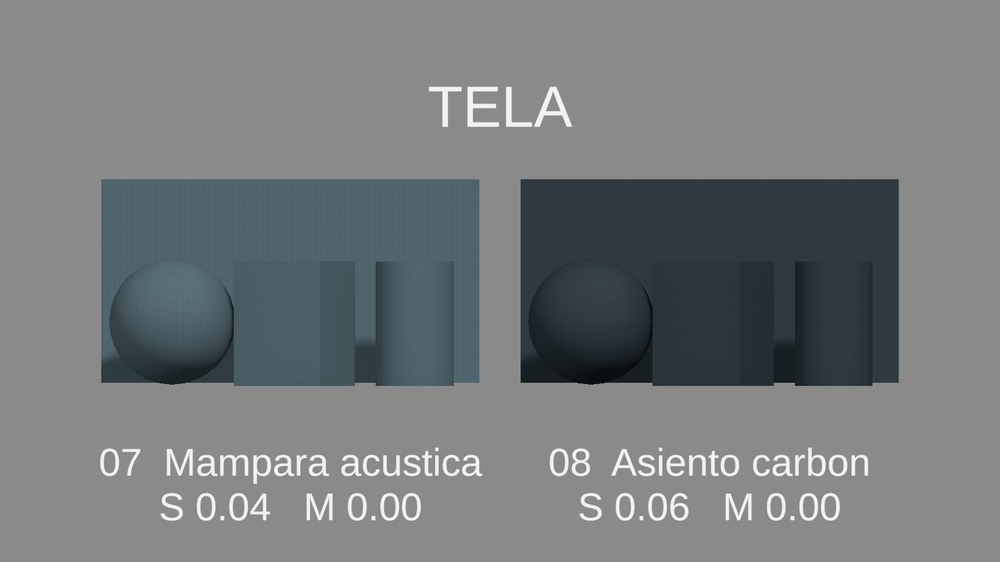
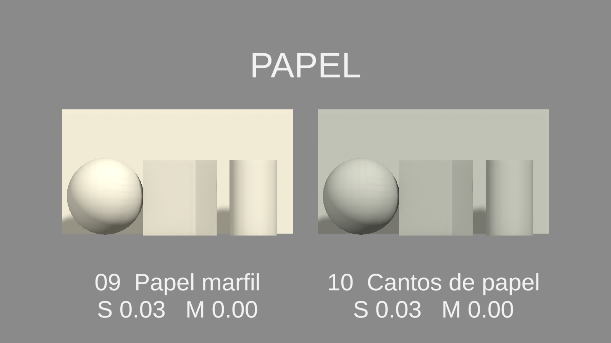
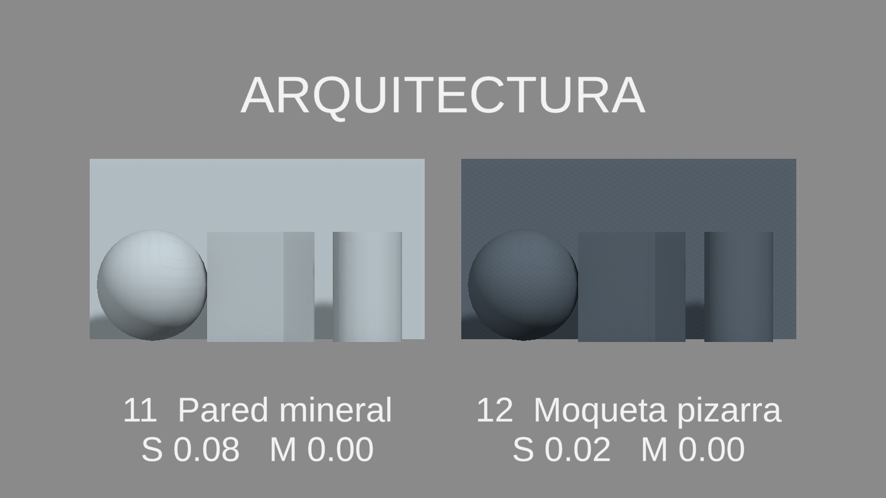

# Catálogo de materiales — capturas reales Unity

Escena: `Assets/_Project/MaterialLibrary/Showcase/MaterialLibrary_Studio.unity`. Unity6000.3.24f1 / URP17.3.0. 12 materiales existentes, seis familias; un gris de estudio nuevo. BancoCorresponsal y materiales previos intactos. [Informe](../../Context/MATERIAL_LIBRARY_REPORT.md).

Iluminación neutra blanca, fondo gris, reflexión baked128, cámara ortográfica, PC_RPAsset sin cambio global ni postprocesado. Renders1600×900, Editor DX11; Android NO PROBADO. S=smoothness; M=metallic. La esfera, cubo, cilindro y placa de cada variante comparten material.

Los siete PNG de la raíz son finales. InitialLighting conserva la iteración descartada por sombras excesivas, no se usa como prueba final. Fechas/coordenadas/perfil en [recibos](capture-receipt.txt); hashes/escena/protección en [manifest](manifest.json). Validación Unity: PASS. Revisión de moiré, compresión y rendimiento en HONOR pendiente.
