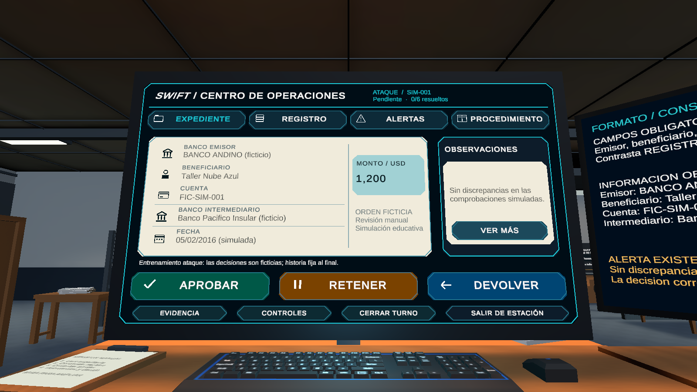
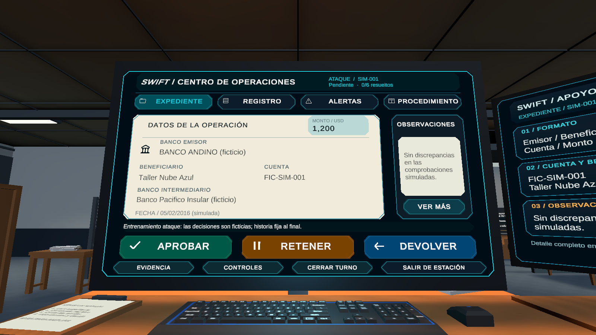
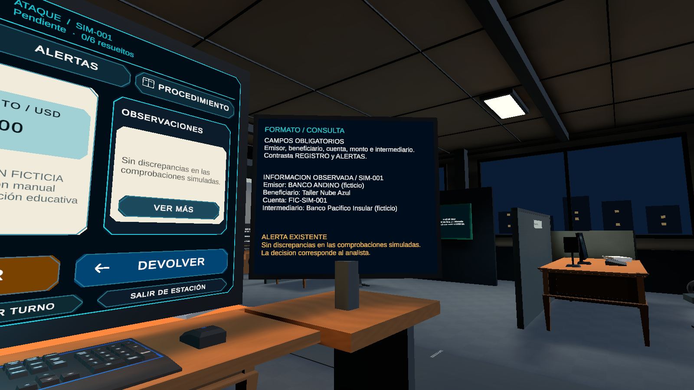
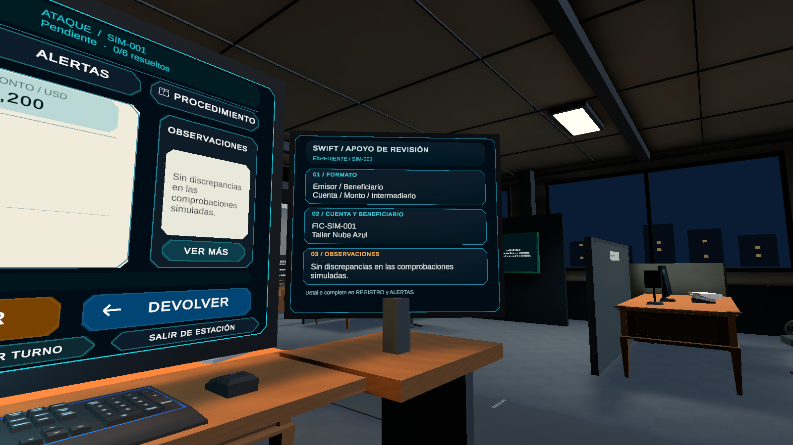

# Comparativa de pantallas de estación

2026-11-04, Lima. Renders reales de Unity 6000.3.24f1 / URP 17.3.0, Editor, no Android. Antes y después se capturaron durante esta tarea; no se reutilizaron imágenes antiguas como capturas nuevas.

| Pantalla | Antes | Después |
|---|---|---|
| Principal en reposo | [Abrir](before/01-idle-main.png) | [Abrir](after/01-idle-main.png) |
| Principal activa | [Abrir](before/02-active-main.png) | [Abrir](after/02-active-main.png) |
| Secundaria activa | [Abrir](before/03-active-secondary.png) | [Abrir](after/03-active-secondary.png) |
| Secundaria en reposo | [Abrir](before/04-idle-secondary.png) | [Abrir](after/04-idle-secondary.png) |

Los cuatro pares usan la misma posición y dirección de cámara: comprobado en `capture.json`. FOV 60°, 1600×900, aspecto 16:9, misma escena, luz y materiales. Las cámaras temporales de documentación se sitúan en el ojo real de la prueba y miran al monitor seleccionado, sin imponer esa orientación al jugador. El jugador simulado mira a otro lado para documentar el reposo sin activar entrada.

Los PNG en la raíz de esta carpeta documentan además las verificaciones de foco, progreso, pestañas, decisiones y salida/reentrada. `receipt.txt` mantiene los timestamps y el historial de iteraciones; `hashes.json` identifica los PNG finales. Las imágenes finales fueron abiertas y revisadas visualmente. No hay retoque ni cambios de URP para estas comparaciones.

[Informe, archivos y pendientes](../../../Archive/2026-11-10/Context/STATION_VISUAL_REFINEMENT.md).
