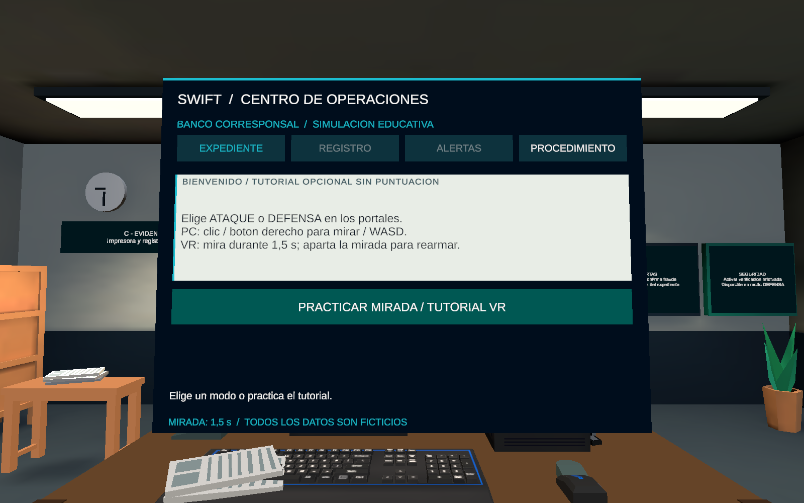
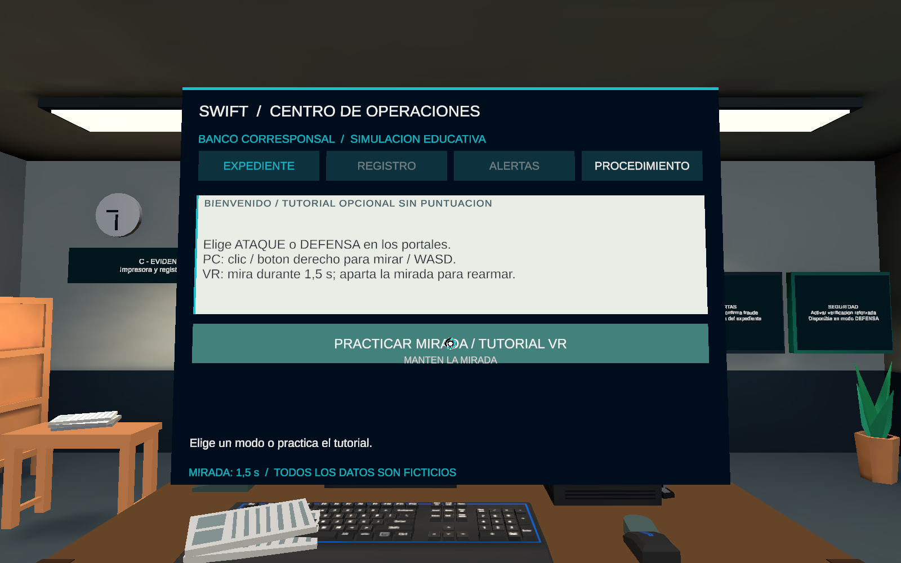
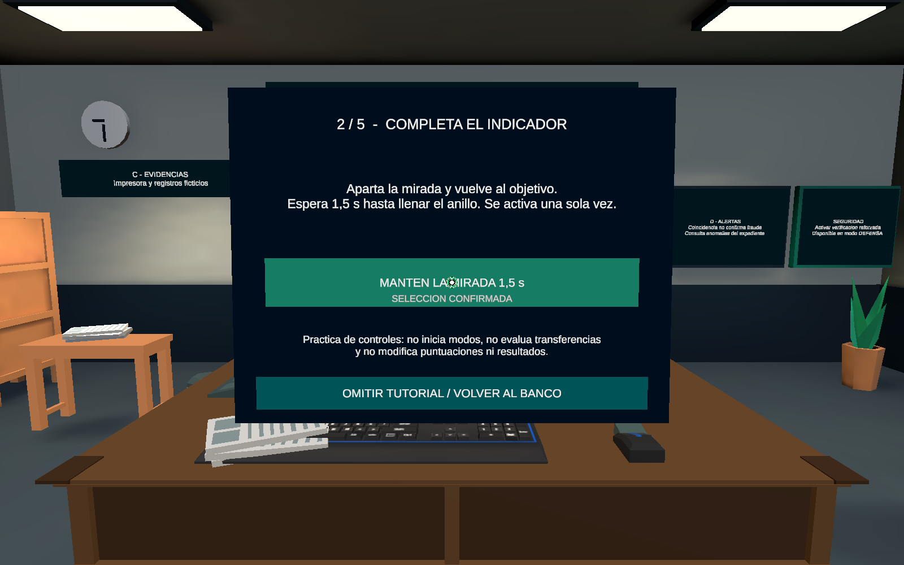
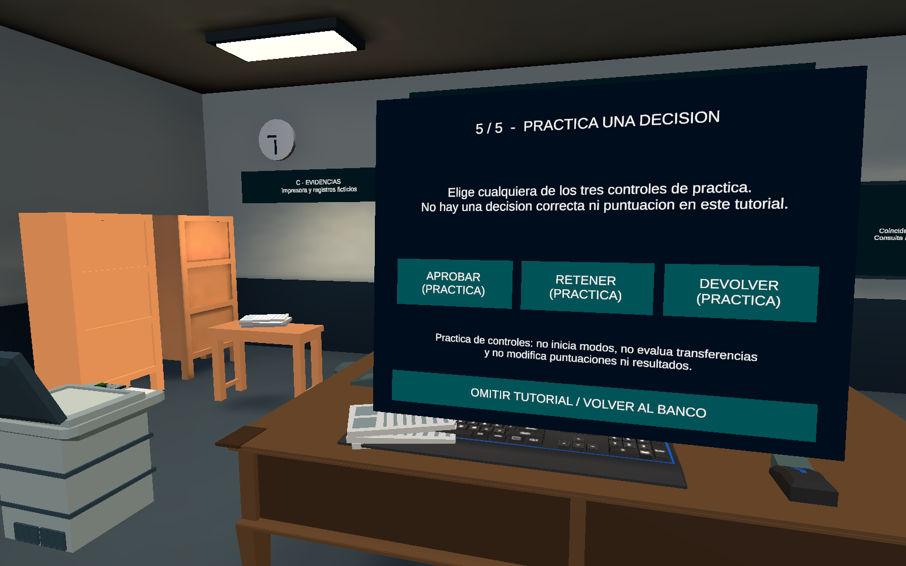
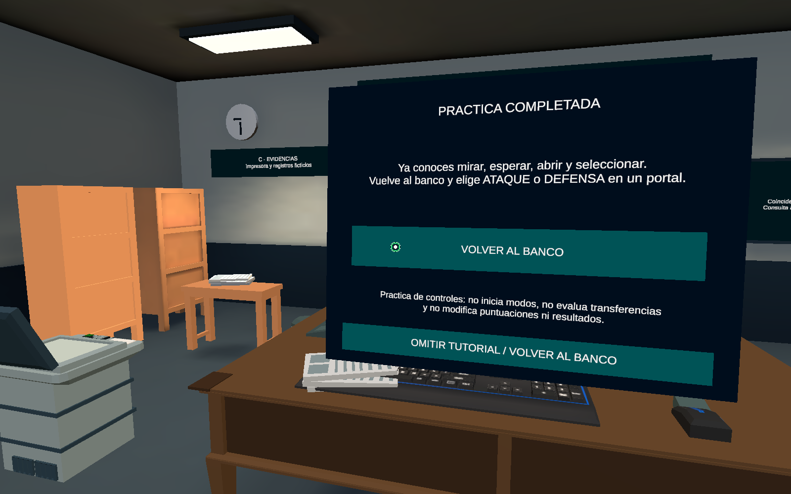
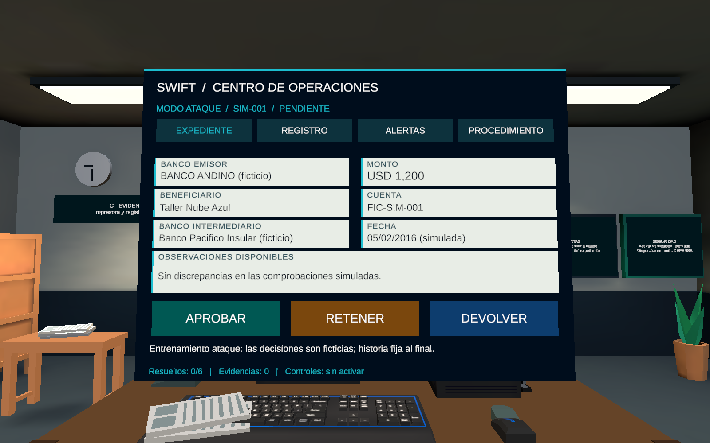
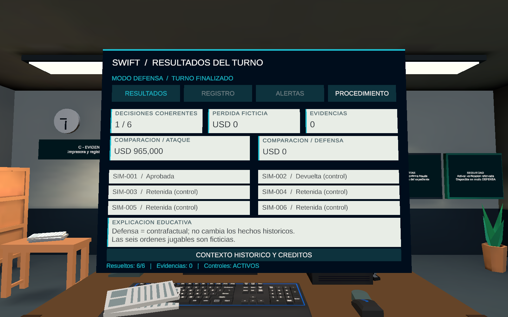

# Revisión UX de BancoCorresponsal

Renders reales de Unity Play Mode, 1600 × 1000, cámara temporal. Captura final y comprobaciones: 2026-11-02 UTC; ver recibo y tests.json. No acredita Android ni aceptación visual en HONOR.

## 01-menu-tutorial

## 02-mirada-progreso

## 03-mirada-confirmacion

## 04-mirada-rearme

## 05-tutorial-decision

## 06-tutorial-completo

## 07-expediente-ux

## 08-resultados-ux

Hashes: capture.json. Los recibos de pruebas son de Editor; el hash de escena corresponde al guardado posterior para publicación.
