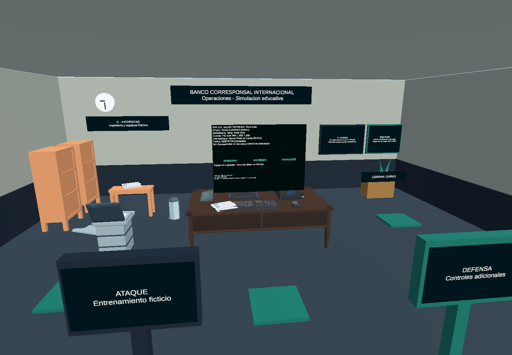

# SWIFT: Código de Alerta

Simulador educativo VR del Banco Corresponsal Internacional, desarrollado en Unity 6
con Google Cardboard. Equipo 05 — A Toda Olla.

- **Unity:** 6000.3.24f1.
- **Render pipeline:** URP 17.3.0.
- **Destino:** Android / Google Cardboard (API mínima 26, target 35, ARM64).
- **Escena principal:** `Assets/_Project/Scenes/BancoCorresponsal.unity`.
- **Repositorio privado:** https://github.com/vierivel1z/Swift_CodigoDeAlerta



Modelos y atribuciones: [Asset Credits](Docs/Context/ASSET_CREDITS.md).

## Estado del prototipo
Oficina Low Poly organizada en entrada, inspección, evidencias y seguridad. Incluye
muebles Kenney, escritorio Quaternius, computadora, impresora y accesorios importados.
La computadora contiene un Canvas World Space/TMP con órdenes ficticias y botones
Aprobar, Retener y Devolver. Impresora, archivadores y paneles utilizan la interacción
existente; hay cuatro destinos de teletransporte.

PC: botón derecho + mouse para mirar, WASD y clic para interactuar. Elegir ATAQUE o
DEFENSA en la entrada. Android utiliza orientación de cabeza y mirada mantenida.
Las pruebas automatizadas de Editor pasaron; la oficina nueva **no ha sido probada
ni medida en un teléfono/visor**. La APK anterior de Artifacts corresponde al prototipo
anterior y no se publica por Git. Para obtener la oficina actual hay que compilar de nuevo.

Todos los datos bancarios son ficticios. El resumen histórico se presenta separado
de la defensa contrafactual. No hay conexiones a sistemas bancarios reales.

## Abrir en la laptop
1. Instalar GitHub Desktop y Git para Windows (comprobar `git --version` en terminal; Unity Package Manager necesita Git en PATH). Iniciar sesión con la cuenta propietaria o una cuenta con
   acceso al repositorio privado.
2. Instalar Unity Hub. En Installs, instalar **Unity 6000.3.24f1**; seleccionar **Android
   Build Support**, **Android SDK & NDK Tools** y **OpenJDK**. Si ya está instalado,
   añadir esos módulos desde el menú de esa versión en Hub.
3. En GitHub Desktop elegir **File > Clone repository > URL** y pegar
   `https://github.com/vierivel1z/Swift_CodigoDeAlerta.git`. Elegir una carpeta local.
4. En Unity Hub usar **Add project from disk** y seleccionar la carpeta que contiene
   `Assets`, `Packages` y `ProjectSettings`; no seleccionar Assets por separado.
5. Abrir con la versión indicada. Esperar la descarga/resolución de paquetes y la
   importación. Se incluyen manifest y packages-lock para conservar las dependencias.
   No migrar URP a Built-in ni sustituir automáticamente versiones de paquetes.
6. Abrir BancoCorresponsal, revisar Console y pulsar Play. Modelos, texturas, materiales,
   prefabs y archivos .meta ya están incluidos; no se necesitan los ZIP originales.

**Library y Temp se regeneran localmente**. Tampoco se sincronizan Logs, UserSettings,
Artifacts, ValidationProject, exportaciones de pruebas ni archivos de IDE generados.
No copiarlos entre PC y laptop ni añadirlos con `git add -f`.

## Android y Google Cardboard
- Verificar en Build Profiles que Android esté disponible y en External Tools las rutas
  del SDK/NDK/JDK instalados por Hub.
- Revisar XR Plug-in Management > Android: Cardboard debe estar seleccionado. Conservar
  la configuración existente y URP. El paquete y su lock están en Packages.
- El ejemplo oficial se encuentra en `Assets/Samples/Google Cardboard XR Plugin for Unity/`.
  Probar primero HelloCardboard en un teléfono real para verificar visor, sensores y QR.
- Después compilar BancoCorresponsal para Android. Confirmar que sea la primera escena
  habilitada del build de la oficina; no utilizar solamente SampleScene o HelloCardboard.
- Probar mirada, teletransporte, campos de expediente, decisiones, defensa, sonido,
  comodidad, legibilidad, pausa/reanudación y rendimiento. Registrar teléfono, Android,
  visor y resultados en KANBAN. No considerar probado VR por pasar Editor.

## Trabajar entre ambas computadoras
1. Antes de empezar: guardar/cerrar cambios locales, **Fetch origin** y **Pull origin**
   en GitHub Desktop; después abrir Unity y esperar la importación.
2. Trabajar en una sola computadora a la vez sobre la misma escena/prefab. Para cambios
   independientes se pueden usar ramas de trabajo.
3. Guardar escenas y assets, esperar compilación y revisar Changes en GitHub Desktop.
   Incluir siempre los `.meta` junto al asset correspondiente.
4. Escribir un mensaje concreto, **Commit to main** (o a la rama de trabajo) y **Push origin**.
5. En la otra computadora repetir Fetch/Pull antes de continuar. Si aparecen conflictos,
   resolverlos conservando ambos trabajos; no utilizar push forzado ni borrar historial.

## Modelos y construcción de escena
- [Créditos, autores, enlaces y licencias](Docs/Context/ASSET_CREDITS.md).
- [Informe de construcción visual](Docs/Context/OFFICE_SCENE_REPORT.md).
- [Kanban](Docs/Context/KANBAN.md).
- [Contexto académico](Docs/Context/PROJECT_CONTEXT.md).
- [Arquitectura y pruebas del prototipo](Docs/Context/PROTOTYPE_GUIDE.md).

Los modelos utilizados están en Assets/Models. Los materiales/prefabs preparados para
URP están en Assets/_Project/OfficeVisual. Los ZIP se conservan localmente en
`External Assets/` y quedan excluidos junto con el alias futuro `ExternalAssets/`.
Office Pack-zip.zip no se utilizó por no incluir autoría/licencia verificable. No se
necesita un importador GLB: se eligieron las variantes FBX/OBJ disponibles.

La escena anterior permanece en `Assets/_Project/Scenes/Backups/`, y su geometría en
`00_Systems/Legacy_Prototype_Preserved` desactivada. No eliminarla sin revisar.
El menú **SWIFT > Construir oficina con modelos importados** conserva una oficina
ya generada y sus ediciones; no regenera destructivamente el montaje.

## Pruebas
```powershell
dotnet run --project Tools/DomainTests/DomainTests.csproj
```
Las verificaciones de oficina usan `Swift.EditorTools.BankOfficeBuilder.Validate` y
`StartPlayValidation` en una copia aislada con Unity batch. No ejecutar otra instancia
batch sobre el mismo proyecto abierto en Unity. Los logs y capturas se guardan en
Artifacts/Office20261028 y se excluyen del repositorio.

Código y montaje asistidos por OpenAI Codex. Geometría provisional y audio sintetizado
para el proyecto; recursos de terceros mantienen sus licencias, incluidas en créditos.

Las pruebas de Tools/DomainTests requieren opcionalmente el SDK .NET 10; abrir y ejecutar el proyecto en Unity utiliza el compilador incluido con el editor.


## GitHub Desktop en esta PC
Añadir el repositorio existente de la carpeta raíz mediante File > Add local repository:
`D:\UnityGames\SWIFT_CodigoDeAlerta`. No elegir la subcarpeta
`D:\UnityGames\SWIFT_CodigoDeAlerta\Swift_CodigoDeAlerta`, que se conserva localmente
como repositorio inicial de Desktop y se excluye del proyecto principal.
Su commit inicial se conserva como antecesor del commit con el proyecto Unity.
